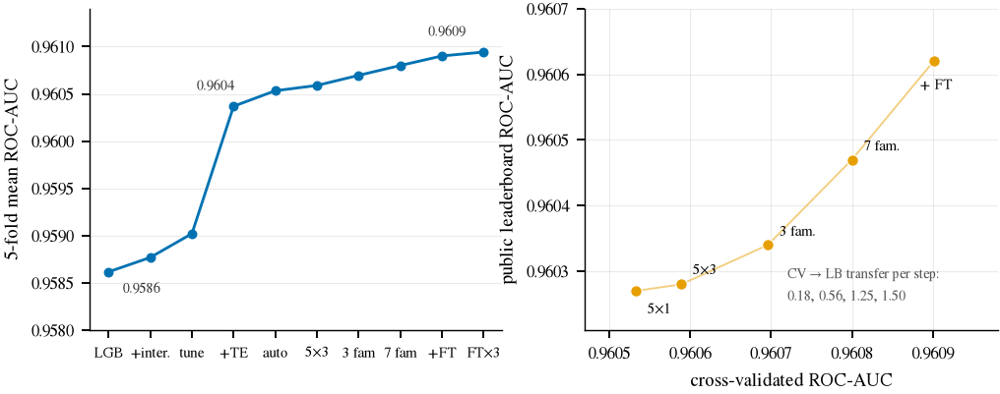

# Airline Satisfaction · Kaggle Playground S6E10

> 在 70 万行合成表格数据上，把"到底是什么在提升 AUC"逐项量出来：固定 5 折、配对 DeLong 检验、每个候选都记录公共榜表现。最终 8 族融合 **CV 0.9609 / private 0.9613**，并附两份文档——一份受控实验研究，一份前十名解法综述。


## 这是什么

Kaggle [Playground Series S6E10](https://www.kaggle.com/competitions/playground-series-s6e10) 的任务是根据乘客与航班信息预测满意度，指标为 ROC-AUC。数据是公开的合成集（699,635 行训练 / 299,844 行测试，21 个特征），排行榜上有三千多支队伍。

这个仓库不是一份"刷榜脚本"，而是一套可复现的实验记录。最初的动机很具体：这个赛题的单模型很快饱和在 0.9605，而论坛里到处是 1e-4 级的"提升"——想知道哪些是真的，只能把每个干预放到同一把尺子上量一遍。

- **同一把尺子**：所有模型共用固定 5 折（seed 42），预处理只在训练折内拟合，比较用配对 DeLong 检验，噪声底约 2.2×10⁻⁴。
- **连负结果一起留档**：哪些干预真的有用、哪些只是动了小数点，都能在报告里查到。
- **两篇成文**：受控研究《Where the Gains Come From》与前十方案综述《How the Top Ten Solved Playground S6E10》。

适合两类读者：想了解"表格数据上什么方法真的有效"的人，以及想复现/延伸这套实验的人。

## 目录

[这是什么](#这是什么) · [结果一览](#结果一览) · [项目结构](#项目结构) · [快速开始](#快速开始) · [常用命令](#常用命令) · [文档与论文](#文档与论文) · [测试](#测试) · [实验约定](#实验约定) · [贡献](#贡献) · [致谢](#致谢) · [许可证](#许可证)

## 结果一览

| 指标 | 分数 | 说明 |
| --- | --- | --- |
| 5 折 CV（均值） | **0.960901** | 8 成员 logit 融合（LightGBM / XGBoost / CatBoost / DART / linear-tree / 2×MLP / FT-Transformer） |
| Public LB | 0.96062 | 提交当时第 1,204 名（共 3,061 队） |
| Private LB | **0.96133** | 最终 1,536 / 3,734 |
| 单模型上限 | 0.960589 | 调参后的 LightGBM + 折内 target statistics |

两篇论文（均为 9 页，含 LaTeX 源码与绘图脚本）：

- [Where the Gains Come From](paper/main.pdf)：特征、模型族、融合三类干预的受控对照，含被否掉的 20 多个想法。
- [How the Top Ten Solved Playground S6E10](paper/solutions/main.pdf)：前十名公开解法的拆解——生成式打分 `p(x|y)` 与公共 OOF 大堆叠两条路线。



*从原始 LightGBM 到 8 族融合：每一格都是同一套折上的实测值，左右两栏分别是 CV 与 public 榜。*

## 项目结构

```
.
├── main.py                  # 命令行入口：preprocess / cv / baseline / evaluate / features / …
├── airline_satisfaction/    # 可复用模块：预处理、交叉验证、基线、调参、融合、神经网络
├── analysis/                # EDA、数据审计、优化回顾（Markdown 报告 + 生成脚本）
├── tests/                   # 标准库 unittest，覆盖泄漏、未知类别、概率边界、ID 对齐
├── paper/                   # 两篇论文的 LaTeX 源码、图表与 PDF
├── data/                    # 竞赛 CSV（不随仓库分发）
└── artifacts/               # 运行产物：模型、OOF、报告、Optuna 数据库（已 gitignore）
```

## 快速开始

**环境**：Python 3.12（本仓库在 Conda 的 `ml` 环境里开发）。依赖见 [requirements.txt](requirements.txt)。

```powershell
conda activate ml
python -m pip install -r requirements.txt
```

**数据**：从比赛页面下载后放进 `data/`，仓库不包含竞赛数据。

```
data/train.csv
data/test.csv
data/sample_submission.csv
```

**跑一遍主流程**（预处理 → 建折 → 基线 → 评估）：

```powershell
python main.py preprocess   # 固定 80/20 分层划分 + 两套预处理器
python main.py cv           # 5 折划分，逐折重新拟合
python main.py baseline     # 常数、逻辑回归、LightGBM、XGBoost、CatBoost
python main.py evaluate     # OOF 报告：ROC/PR、校准、混淆矩阵、逐折 AUC
```

想直接看最终模型是怎么来的，按 [paper/main.pdf](paper/main.pdf) 的章节顺序跑 `features → targetstats → explore → tune → final`。

## 常用命令

| 命令 | 作用 | 主要产物 |
| --- | --- | --- |
| `python main.py preprocess` | 预处理与固定划分 | `artifacts/preprocessing.joblib` |
| `python main.py cv` | 5 折 CV 划分与逐折预处理器 | `artifacts/cv/folds.csv` |
| `python main.py baseline [--models xgboost catboost]` | 五个基线模型 | `artifacts/baseline/` |
| `python main.py evaluate` | 评估 OOF 预测 | `artifacts/evaluation/REPORT.md` |
| `python main.py features` | 特征消融实验 | `artifacts/features/` |
| `python main.py targetstats` | 折内交叉拟合的 target statistics | `artifacts/target_statistics/` |
| `python main.py explore` | LightGBM 目标统计方向探索 | `artifacts/lgbm_exploration/` |
| `python main.py tune --trials 16` | Optuna 调参 | `artifacts/tuning/study.db` |
| `python main.py ensemble` | 多模型融合比较与复核 | `artifacts/ensemble/` |
| `python main.py final --seeds 42 1042 2042` | 多随机种子的最终训练 | `artifacts/final/` |
| `python main.py multimodel --weights 0.8 0.1 0.1` | 三族 logit 融合（需 torch） | `artifacts/multimodel/` |

每个命令都支持 `--help`；换数据或换划分时请用新的 `--output-dir`，避免旧产物被覆盖。

## 文档与论文

| 文档 | 内容 |
| --- | --- |
| [analysis/EDA.md](analysis/EDA.md) | 数据规模、分布、标签与评分曲线（`python analysis/eda.py`） |
| [analysis/AUDIT.md](analysis/AUDIT.md) | 标签噪声、评分 0 的语义、对抗验证、与原始调查数据的对照（`python analysis/audit.py`） |
| [analysis/OPTIMIZATION_REVIEW.md](analysis/OPTIMIZATION_REVIEW.md) | 优化空间与路线图：还值得试什么 |
| [paper/main.pdf](paper/main.pdf) | 受控实验研究，构建方式见 [paper/README.md](paper/README.md) |
| [paper/solutions/main.pdf](paper/solutions/main.pdf) | 前十名解法综述，构建方式见 [paper/solutions/README.md](paper/solutions/README.md) |

重画论文图：

```powershell
python paper/figures/make_figures.py <publicleaderboard.csv>   # 研究论文的 5 张图
python paper/solutions/figures.py                              # 综述的 3 张图（需先下载榜单快照）
```

综述的图依赖 `artifacts/solutions/` 下的榜单快照，可用 `kaggle competitions leaderboard` 重新获取，具体命令写在论文第 9 节。

## 测试

```powershell
python -m unittest discover -s tests -v
```

测试重点是有没有偷偷泄漏：折内拟合、未知类别、概率边界、ID 顺序、保存的 Pipeline 能否重载并复现预测。

## 实验约定

这些规则固定在代码与评审流程里，改实验时请一并遵守：

- 折与随机种子固定；换协议就换输出目录，不覆盖旧结果。
- 所有会用到标签的变换（target encoding、teacher 特征）只在训练折内拟合，外层验证折用内层交叉拟合。
- 融合属于实验性方案：默认不启用，必须显式加 `--adopt-blend` 才更新当前提交。
- `data/` 与 `artifacts/` 不入库；提交 Kaggle 需显式要求。

完整规范见 [AGENTS.md](AGENTS.md)。

## 贡献

欢迎提 issue 或 PR。改动行为时请补对应的单元测试，并在 PR 里写清验证命令、实验参数与配对分数；纯文档修复可以直接提交。

## 致谢

- 比赛与数据：[Kaggle Playground Series S6E10](https://www.kaggle.com/competitions/playground-series-s6e10)。
- 综述部分引用了 1/4/5/7/9/11/16/25/28/29 名队伍的公开 write-up，链接都在 [paper/solutions/references.bib](paper/solutions/references.bib)。
- 主要开源依赖：scikit-learn、LightGBM、XGBoost、CatBoost、Optuna、PyTorch、pandas、matplotlib。

## 许可证

本仓库目前为私有项目，未声明开源许可证；如需对外开源，请先确认竞赛数据与第三方内容的许可。竞赛数据版权归 Kaggle 与原数据提供方所有，本仓库不再分发。

