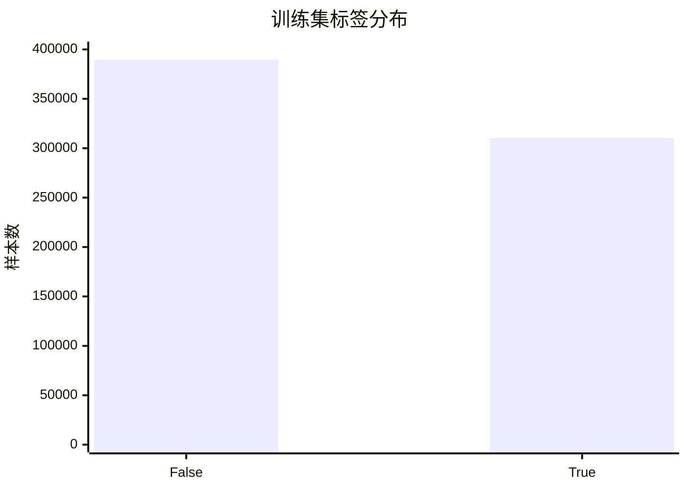

# 航空旅客满意度 EDA

来源：data/train.csv、data/test.csv、data/sample_submission.csv。以下统计使用完整文件，每行作为一条样本。满意率 = satisfaction=True 样本数 / 该组样本数。

## 数据规模

| 文件 | 样本数 | 列数 |
| --- | --- | --- |
| train.csv | 699635 | 23 |
| test.csv | 299844 | 22 |
| sample_submission.csv | 299844 | 2 |

训练集包含 21 个候选特征、1 个 id 和 1 个标签。

## 特征类型

存储类型为 pandas.read_csv 的推断结果。评分字段按离散评分解释。

| 字段 | pandas 类型 | 语义 | 训练非空取值数 | 测试非空取值数 |
| --- | --- | --- | --- | --- |
| id | int64 | 标识符，基线移除 | 699635 | 299,844.0000 |
| Age | int64 | 数值测量 | 75 | 75.0000 |
| Flight Distance | int64 | 数值测量 | 3474 | 3,317.0000 |
| Inflight wifi service | int64 | 离散评分 | 6 | 6.0000 |
| Departure/Arrival time convenient | int64 | 离散评分 | 6 | 6.0000 |
| Ease of Online booking | int64 | 离散评分 | 6 | 6.0000 |
| Gate location | int64 | 离散评分 | 6 | 6.0000 |
| Food and drink | int64 | 离散评分 | 6 | 6.0000 |
| Online boarding | int64 | 离散评分 | 6 | 6.0000 |
| Seat comfort | int64 | 离散评分 | 6 | 6.0000 |
| Inflight entertainment | int64 | 离散评分 | 6 | 6.0000 |
| On-board service | int64 | 离散评分 | 6 | 6.0000 |
| Leg room service | int64 | 离散评分 | 6 | 6.0000 |
| Baggage handling | int64 | 离散评分 | 5 | 5.0000 |
| Checkin service | int64 | 离散评分 | 6 | 6.0000 |
| Cleanliness | int64 | 离散评分 | 6 | 6.0000 |
| Departure Delay in Minutes | int64 | 数值测量 | 167 | 135.0000 |
| Arrival Delay in Minutes | float64 | 数值测量 | 168 | 128.0000 |
| Gender | str | 无序类别 | 2 | 2.0000 |
| Customer Type | str | 无序类别 | 2 | 2.0000 |
| Type of Travel | str | 无序类别 | 2 | 2.0000 |
| Class | str | 无序类别 | 3 | 3.0000 |
| satisfaction | bool | 二元标签 | 2 | — |

特征组成：4 个数值测量、13 个离散评分、4 个无序类别。

Gender: Female, Male；Customer Type: Loyal Customer, disloyal Customer；Type of Travel: Business travel, Personal Travel；Class: Business, Eco, Eco Plus

## 缺失值

| 文件 | 字段 | 缺失数 | 缺失率 (%) |
| --- | --- | --- | --- |
| train | Arrival Delay in Minutes | 292 | 0.0417 |
| test | Arrival Delay in Minutes | 130 | 0.0434 |

其余字段缺失数为 0，训练标签完整。到达延误可由 LightGBM 原生处理，或在训练折内拟合中位数填充，并比较增加缺失指示的效果。

## 标签分布

| 标签 | 样本数 | 占比 (%) |
| --- | --- | --- |
| 0 (False) | 389296 | 55.6427 |
| 1 (True) | 310339 | 44.3573 |

满意率 44.3573%；多数类 Accuracy 基线 55.6427%。优先分层划分，保留原始类别比例。



## 数值分布与评分取值

| 字段 | min | 1% | 25% | 50% | 75% | 99% | max | mean |
| --- | --- | --- | --- | --- | --- | --- | --- | --- |
| Age | 7.0000 | 9.0000 | 27.0000 | 40.0000 | 50.0000 | 68.0000 | 85.0000 | 39.0019 |
| Flight Distance | 67.0000 | 160.0000 | 631.0000 | 954.0000 | 1,814.0000 | 3,873.0000 | 4,983.0000 | 1,353.7787 |
| Departure Delay in Minutes | 0.0000 | 0.0000 | 0.0000 | 0.0000 | 0.0000 | 30.0000 | 489.0000 | 1.1762 |
| Arrival Delay in Minutes | 0.0000 | 0.0000 | 0.0000 | 0.0000 | 0.0000 | 28.0000 | 491.0000 | 1.1343 |

| 字段 | 训练取值 | 零值数 | 零值占比 (%) |
| --- | --- | --- | --- |
| Inflight wifi service | 0, 1, 2, 3, 4, 5 | 13102 | 1.8727 |
| Departure/Arrival time convenient | 0, 1, 2, 3, 4, 5 | 25751 | 3.6806 |
| Ease of Online booking | 0, 1, 2, 3, 4, 5 | 16073 | 2.2973 |
| Gate location | 0, 1, 2, 3, 4, 5 | 1455 | 0.2080 |
| Food and drink | 0, 1, 2, 3, 4, 5 | 1014 | 0.1449 |
| Online boarding | 0, 1, 2, 3, 4, 5 | 9147 | 1.3074 |
| Seat comfort | 0, 1, 2, 3, 4, 5 | 838 | 0.1198 |
| Inflight entertainment | 0, 1, 2, 3, 4, 5 | 1020 | 0.1458 |
| On-board service | 0, 1, 2, 3, 4, 5 | 801 | 0.1145 |
| Leg room service | 0, 1, 2, 3, 4, 5 | 1693 | 0.2420 |
| Baggage handling | 1, 2, 3, 4, 5 | 0 | 0.0000 |
| Checkin service | 0, 1, 2, 3, 4, 5 | 929 | 0.1328 |
| Cleanliness | 0, 1, 2, 3, 4, 5 | 945 | 0.1351 |

起飞延误零值占 90.78%；到达延误零值占全部训练样本的 91.54%。延误分布集中于零并有右长尾。

年龄、航程和延误均未发现负值。先保留长尾样本。评分 0 的业务定义需查比赛字段说明，当前保留原值。

## 特征与标签的关系

以下为训练集单变量描述性关联；模型效果使用独立验证评估。

| 字段 | 取值 | 样本数 | 满意率 (%) |
| --- | --- | --- | --- |
| Gender | Female | 347952 | 43.7994 |
| Gender | Male | 351683 | 44.9092 |
| Customer Type | Loyal Customer | 576990 | 49.5145 |
| Customer Type | disloyal Customer | 122645 | 20.0946 |
| Type of Travel | Business travel | 497441 | 58.4337 |
| Type of Travel | Personal Travel | 202194 | 9.7263 |
| Class | Business | 342212 | 72.5311 |
| Class | Eco | 327404 | 16.7558 |
| Class | Eco Plus | 30019 | 24.2180 |
| Inflight wifi service | 0 | 13102 | 88.7345 |
| Inflight wifi service | 1 | 107739 | 39.0666 |
| Inflight wifi service | 2 | 186870 | 27.0429 |
| Inflight wifi service | 3 | 184436 | 27.6231 |
| Inflight wifi service | 4 | 128136 | 62.2214 |
| Inflight wifi service | 5 | 79352 | 95.0360 |
| Online boarding | 0 | 9147 | 62.0422 |
| Online boarding | 1 | 57588 | 10.5282 |
| Online boarding | 2 | 119297 | 8.5358 |
| Online boarding | 3 | 149783 | 12.8372 |
| Online boarding | 4 | 210950 | 64.1915 |
| Online boarding | 5 | 152870 | 87.5110 |

Wi-Fi 评分 0 的满意率为 88.73%，在线登机评分 0 的满意率为 62.04%，评分与满意率存在非单调关系。先保留 0 值，避免全区间单调约束。

数值特征与标签的 Pearson 相关系数（到达延误使用非缺失样本）：

| 字段 | Pearson r |
| --- | --- |
| Online boarding | 0.5596 |
| Inflight entertainment | 0.4308 |
| Seat comfort | 0.4015 |
| Flight Distance | 0.3700 |
| On-board service | 0.3466 |
| Cleanliness | 0.3389 |
| Leg room service | 0.3301 |
| Inflight wifi service | 0.2913 |
| Baggage handling | 0.2581 |
| Checkin service | 0.2498 |
| Food and drink | 0.2181 |
| Age | 0.2027 |
| Ease of Online booking | 0.1909 |
| Arrival Delay in Minutes | -0.0516 |
| Departure/Arrival time convenient | -0.0492 |
| Departure Delay in Minutes | -0.0358 |
| Gate location | 0.0228 |

Online boarding 的线性关联最强。舱位、出行类型、客户类型也呈现明显的分组满意率差异。

数值特征两两相关性最高的组合：

| 字段 A | 字段 B | Pearson r |
| --- | --- | --- |
| Departure Delay in Minutes | Arrival Delay in Minutes | 0.8420 |
| Inflight wifi service | Ease of Online booking | 0.7720 |
| Seat comfort | Cleanliness | 0.7626 |
| Inflight entertainment | Cleanliness | 0.7510 |
| Seat comfort | Inflight entertainment | 0.7448 |
| Food and drink | Cleanliness | 0.6782 |
| Food and drink | Inflight entertainment | 0.6565 |
| Food and drink | Seat comfort | 0.6560 |

## 数据质量与训练/测试一致性

| 检查项 | 结果 |
| --- | --- |
| 特征列名和顺序一致 | True |
| 训练重复 id | 0 |
| 测试重复 id | 0 |
| 训练/测试 id 交集 | 0 |
| 训练重复特征行（排除 id、标签） | 0 |
| 测试重复特征行（排除 id） | 0 |
| 测试样本与训练样本特征完全相同行数 | 0 |
| 提交样例行数与测试一致 | True |
| 提交样例 id 顺序与测试一致 | True |

| 字段 | 最大取值占比差 (百分点) | 训练均值 | 测试均值 | 测试新增类别/评分数 |
| --- | --- | --- | --- | --- |
| Age | — | 39.0019 | 38.9930 | — |
| Flight Distance | — | 1,353.7787 | 1,353.3689 | — |
| Inflight wifi service | 0.0434 | 2.7787 | 2.7766 | 0.0000 |
| Departure/Arrival time convenient | 0.1394 | 3.1562 | 3.1516 | 0.0000 |
| Ease of Online booking | 0.0642 | 2.8132 | 2.8126 | 0.0000 |
| Gate location | 0.0429 | 3.0137 | 3.0131 | 0.0000 |
| Food and drink | 0.1494 | 3.2656 | 3.2700 | 0.0000 |
| Online boarding | 0.1119 | 3.3642 | 3.3657 | 0.0000 |
| Seat comfort | 0.1369 | 3.5689 | 3.5721 | 0.0000 |
| Inflight entertainment | 0.1412 | 3.4539 | 3.4560 | 0.0000 |
| On-board service | 0.1307 | 3.5174 | 3.5133 | 0.0000 |
| Leg room service | 0.1112 | 3.4728 | 3.4686 | 0.0000 |
| Baggage handling | 0.1521 | 3.8054 | 3.8024 | 0.0000 |
| Checkin service | 0.1266 | 3.4203 | 3.4216 | 0.0000 |
| Cleanliness | 0.2139 | 3.3804 | 3.3851 | 0.0000 |
| Departure Delay in Minutes | — | 1.1762 | 1.1566 | — |
| Arrival Delay in Minutes | — | 1.1343 | 1.1202 | — |
| Gender | 0.1536 | — | — | 0.0000 |
| Customer Type | 0.1421 | — | — | 0.0000 |
| Type of Travel | 0.0161 | — | — | 0.0000 |
| Class | 0.0443 | — | — | 0.0000 |

本次均值、类别频率和评分频率检查显示训练/测试分布接近，测试无新增类别或评分取值。后续可使用分位数比较和对抗验证检查联合分布差异。

提交样例 satisfaction 只有 1 个取值：0.44357272006117476，与训练满意率一致。提交文件采用 id 和概率格式，官方评估指标需查比赛页面。

## 下一步计划

1. 确认比赛链接、官方评估指标、评分 0 的定义及数据来源，确定主要验证指标。

2. 固定 random_state=42，按标签做 80%/20% 分层划分。基线移除 id；所有填充、编码与特征选择在训练折内拟合。

3. 建立常数概率和逻辑回归基线。逻辑回归采用数值填充及标准化、类别独热编码。再训练 LightGBM，显式指定四个类别字段，保留评分原值并使用早停。暂记 ROC-AUC、Log Loss、Accuracy、F1，确认官方指标后以其为主。

4. 在同一划分逐项比较缺失指示、延误 log1p/是否延误、服务评分汇总、舱位与出行类型交互。结合分组误差与置换重要性，保留验证有效的特征。

5. 对有效方案做 5 折分层交叉验证，记录均值和标准差。按验证需求决定概率校准或阈值优化。最终全训练集重训，按提交样例 id 顺序导出正类概率，检查行数、空值和 [0,1] 范围。

## 复现

在项目根目录执行：

```powershell
python analysis/eda.py
```

依赖为项目已有 pandas。脚本读取 data/，生成 analysis/EDA.md。此次完成 EDA，模型训练留待下一阶段。
